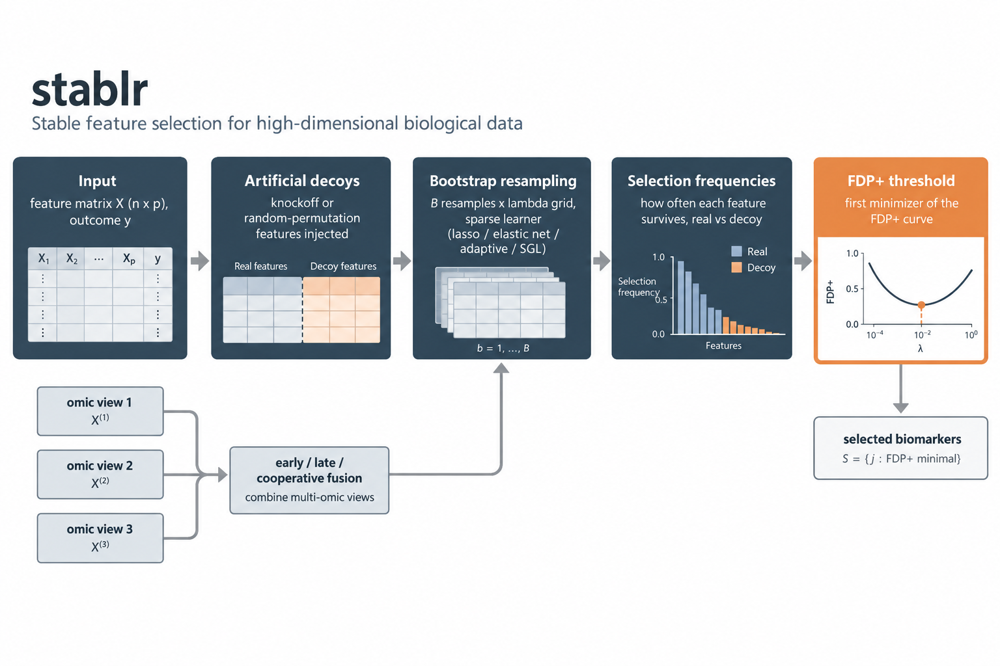

# stablr: Sparse and Reliable Biomarker Discovery in R

### R-native STABL: sparse, stable biomarker selection with false-discovery calibration

The `stablr` package implements STABL (Stability-based Thresholding and
Aggregation for Biomarker discovery via LASSO) for high-dimensional clinical
and omic data. The method repeats three steps. It resamples the data. It fits
a sparse learner across a penalty grid. It records how often each feature is
selected. It then calibrates these selection frequencies against artificial
decoy features. The package keeps the parity-critical STABL semantics of the
Python implementation. It exposes R-native S3 objects, `glmnet`-ecosystem
learners, multi-omic workflows, visualization helpers, and CSV/disk export
utilities. It compiles C++ but has no Python or tidymodels runtime dependency.

Major functionality of `stablr`:

+ [`stabl()`](reference/stabl.html)                     Simple selector: a data.frame in, a plain-language selection out
+ [`stabl_fit()`](reference/stabl_fit.html)                    Expert interface: full control of lambda grid, bootstrap design, thresholds, and learners
+ [`compute_fdp_plus()`](reference/compute_fdp_plus.html)               FDP+ thresholding with random-permutation and knockoff artificial features
+ [`stabl_multiomic_train_validate()`](reference/stabl_multiomic_train_validate.html)  Multi-omic train/validation with early, late, and cooperative fusion
+ [`stabl_multiomic_nested_cv()`](reference/stabl_multiomic_nested_cv.html)     Outer CV with sample-i.i.d., grouped, or study-disjoint folds
+ [`stabl_multiomic_scheme_comparison()`](reference/stabl_multiomic_scheme_comparison.html) Compare CV schemes arm-by-arm on held-out error
+ [`stabl_environment_stability()`](reference/stabl_environment_stability.html) Transportable selections across environments (experimental)
+ [`jaccard_similarity_matrix()`](reference/jaccard_similarity_matrix.html)    Selection-reproducibility metrics

## Resources

+ Hédou, J., Marić, I., Bellan, G. et al. Discovery of sparse, reliable omic
  biomarkers with Stabl. <u>Nat Biotechnol</u> (2024).
  [doi:10.1038/s41587-023-02033-x](https://doi.org/10.1038/s41587-023-02033-x)
+ Ding, Y. D., Li, S., Narasimhan, B., Tibshirani, R. J. Cooperative learning
  for multi-view analysis. <u>PNAS</u> (2022).
  [doi:10.1073/pnas.2202113119](https://doi.org/10.1073/pnas.2202113119)
+ [Documentation website](https://mdmanurung.github.io/stablr/) and the
  Vignettes menu above for executable tutorials
+ [Release governance and review status](https://github.com/mdmanurung/stablr/blob/main/docs/RELEASE_STATUS.md)

## Motivation

A high-dimensional biomarker screen begins with an uncomfortable fact: there
are many more tempting variables than there are samples. A sparse model can still choose a short list. But a single fit does not tell
whether the list is sturdy or merely lucky. A selection that reproduces only
inside its own sampling scheme has little value for a new cohort or a new lab.

STABL turns the one-shot question into a repeated experiment. Bootstrap resampling paired with artificial decoy features converts selection
frequency into a calibrated decision. A feature is retained only when it
out-competes decoys that carry no signal. The fitted threshold is the first
minimizer of the observed FDP+ diagnostic curve. `stablr` extends the same discipline
across omic views (early, late, and cooperative fusion) and across
environments and studies (grouped and study-disjoint resampling), so that
reliability and transportability are measured rather than assumed.

## stablr workflow



### Analysis modes (binary outcomes)

`stabl_analyze()` makes the evidence level explicit via a required `mode`
argument. `mode = "exploratory"` fits STABL on the full data and returns a
canonical interpretation table (`stabl_interpret()`) labelled
`post_selection_descriptive` — coefficients, stability, effect directions,
and correlation groups describe the fitting data and are not predictive
evidence. `mode = "validated"` (binary only) runs nested cross-validation
with fold-fitted preprocessing (`stabl_preprocess_fit()` /
`stabl_preprocess_apply()`) and returns held-out predictions, pooled and
per-repeat performance (accuracy, balanced error rate, macro-F1, MCC,
Brier, log-loss, AUROC), and held-out permutation importance labelled
`cross_validated`.

Evidence status (simulation-only, predeclared gates,
`benchmarks/iv_summary.md`): effect-direction recovery 1.00; null
validated AUROC centred at chance (median 0.473); leaky full-data
selection is directionally optimistic over nested validation (+0.015 mean
AUROC); one-feature folds produce non-degenerate probabilities. One
predeclared criterion was NOT met: correlated substitutes are always
assigned to a single correlation group when co-selected, but FDP+
selection retains all members of a correlated block in only 60% of runs —
do not expect complete co-selection of redundant features. Multiclass and
ordinal graduation remain reserved (WS-9 ordinal graduation NOT met).

## Technical intro

`stablr` is R-native without a Python runtime. The core STABL method is
parity-tested against the Python STABL implementation (Hédou et al. 2024);
cross-language solver validation uses ranking/support contracts and does not
claim bit-identical coefficients. The cooperative-learning backend is
compiled C++17 (vendored multiview engine), and learners come from the
`glmnet` ecosystem: lasso, elastic net, adaptive lasso, and optional sparse
group lasso, with gaussian, binomial, multinomial, and Cox outcomes where the
backend supports the family. A random-forest learner (`ranger`) and an
ordinal-regression learner (`ordinalNet`) are also available as base learners.

The interface is two-tier. `stabl()` runs STABL with statistically safe
defaults — model-X knockoff artificial features, FDP+ calibration, strict
fallback, automatic lambda grid — and prints a plain-language answer:

```r
library(stablr)
fit <- stabl(df, y = "response", n_bootstraps = 1000L, random_state = 42L)
fit                    # plain-language answer
feature_names(fit)     # the selected features
plot(fit)              # stability paths + FDP+ curve
```

`stabl_fit()` exposes every argument — lambda grids, bootstrap design,
thresholds, learner adapters, sample grouping — and every accessor and
workflow applies to both objects. See `?stabl_fit` and the vignettes.

Everything beyond core STABL is labelled as an extension. Cooperative fusion
(Ding et al. 2022) ships on the vendored multiview engine for gaussian and
binomial families (Cox deferred). The random-forest learner is calibrated for
scoped settings: linear and nonlinear gaussian problems with up to a few
dozen predictors (see `?make_ranger_adapter`). The ordinal learner is
experimental pending its calibration study (see `?make_ordinal_adapter`).
The environment-stability workflow aggregates per-environment selections by
their minimum frequency; it is calibrated for small feature panels (see
`?stabl_environment_stability`).

Interpretation limits are part of the contract. The fitted threshold is the
first minimizer of the observed FDP+ curve; a plotted `fdr_target` is a
visual reference, not a fitting target, and neither is a universal
false-discovery guarantee. Knockoff modes fail closed above 3,000 predictors
because a globally valid chunked construction has not been established;
random-permutation controls remain available at larger dimensions.

## Install

`stablr` compiles a C++17 native cooperative-learning backend at install
time. You need a C++17-capable compiler toolchain:

- **Windows:** [Rtools](https://cran.r-project.org/bin/windows/Rtools/) (Rtools42 or later)
- **macOS:** Xcode Command Line Tools (`xcode-select --install`)
- **Linux:** GCC ≥ 7 or Clang ≥ 5 (usually pre-installed; install via `apt install r-base-dev` or equivalent)

### Install

```r
# Install from GitHub
remotes::install_github("mdmanurung/stablr")

# Or from a local clone, from the repository root:
devtools::install_local(".")
```

### Dependencies

Optional functionality uses optional packages, in case these aren't installed
automatically:

```r
install.packages(c("ggplot2", "knockoff", "future", "furrr", "sparsegl"))
```

- `ggplot2`: plotting helpers and saved result figures
- `knockoff`: `artificial_type = "knockoff"`, `"knockoff_equi"`, or `"knockoff_mvr"`
- `future`, `furrr`: parallel bootstrap execution
- `sparsegl`: `base_learner = "sparse_group_lasso"`
- `mixOmics`: TCGA vignette dataset
