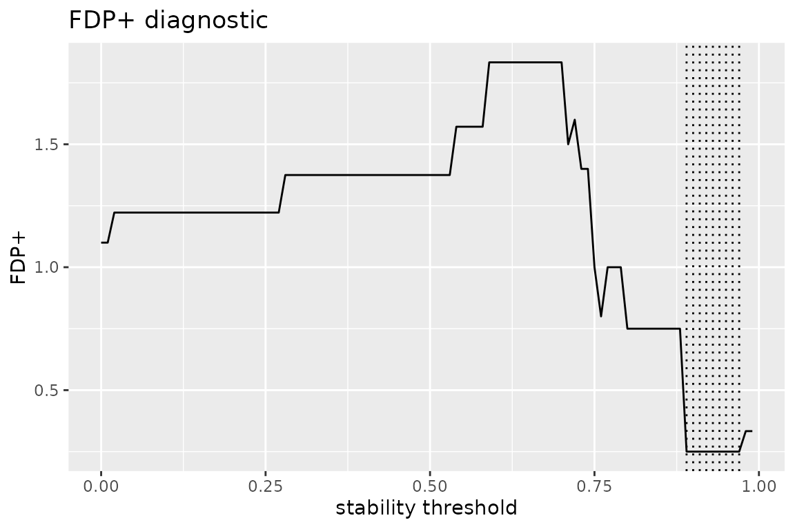
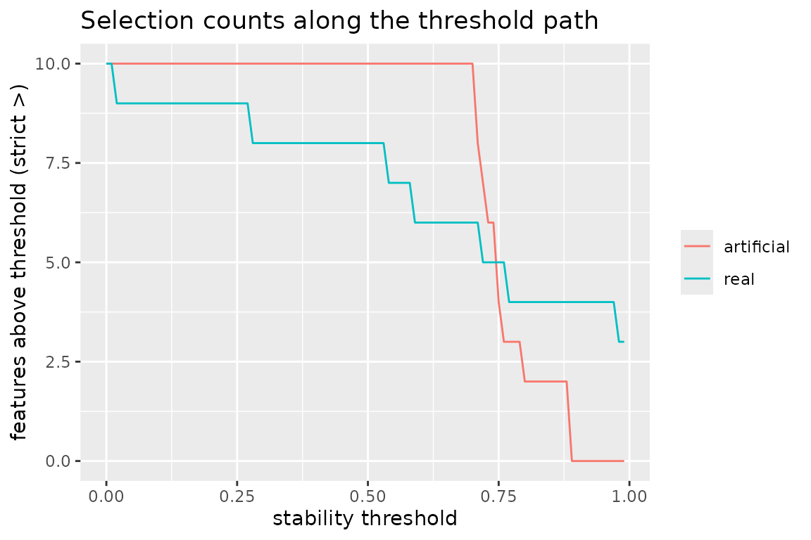
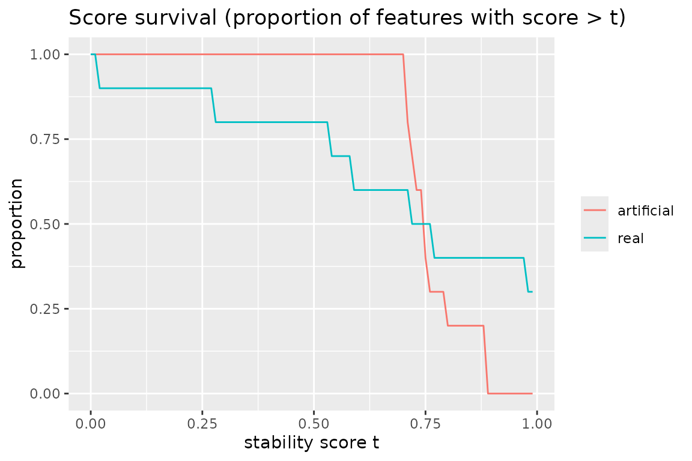

# Single-cell latent factors: STABL on cEBMF-denoised expression

## Contents

- 1 Introduction
- 2 The upstream cEBMF fit (Python)
- 3 Loading the bundled fixture
- 4 A cell-identity outcome
- 5 Selection on the denoised matrix
- 6 Comparison with the raw-normalized matrix
- 7 Why not select on the factor scores directly?
- 8 Mapping selected genes back to factors
- 9 Reproducibility

## 1 Introduction

Covariate-moderated empirical Bayes matrix factorization (cEBMF; Denault
et al., 2025, <https://arxiv.org/abs/2505.11639>) factorizes an
expression matrix into a small number of latent factors whose priors can
be modulated by side information, yielding a low-rank **denoised**
representation of each cell. A natural downstream question is: which
genes *reliably* carry a biological signal in that denoised
representation? STABL answers exactly this kind of question — it couples
a penalized learner with bootstrap resampling and an artificial-feature
null to select only features whose association with the outcome is
stable.

This vignette demonstrates the combination on the public 10x Genomics
PBMC 3k data set (2,700 peripheral blood mononuclear cells, hg19):

1.  a cEBMF factorization of the expression matrix (run offline with the
    Python package `cebmf_torch`; the code is shown but not evaluated
    here), and
2.  [`stabl_fit()`](https://mdmanurung.github.io/stablr/reference/stabl_fit.md)
    selection on the cEBMF-denoised expression matrix, compared with the
    same selection on the raw-normalized matrix.

The denoised matrix is a rank-10 reconstruction, so its 1,200 genes lie
in a 10-dimensional subspace; Section 7 discusses what that implies for
the selection machinery.

## 2 The upstream cEBMF fit (Python)

The bundled fixture was produced with `cebmf_torch`
(<https://github.com/william-denault/cebmf_torch>), the PyTorch
implementation of cEBMF. The complete, seeded generation script ships
with the package source under `data-raw/prepare_pbmc3k_fixtures.py`; the
essential steps are:

``` python
import torch
from cebmf_torch import cEBMF

# Y: cells x genes log-normalized matrix (CP10k + log1p), 1,200 HVGs
torch.manual_seed(20261020)
model = cEBMF(Y, K=10, prior_L="norm", prior_F="norm")
fit = model.fit(maxit=50)
L = fit.L   # cells x K factor scores
F = fit.F   # genes x K loadings
```

With no covariate matrices (`X_l`, `X_f`) supplied, cEBMF reduces to
adaptive EBMF; the covariate-moderated priors are drop-in and do not
change anything about the downstream STABL analysis. The run is CPU
feasible (minutes for this matrix size).

## 3 Loading the bundled fixture

The fixture stores the factor scores `L` (2,700 cells x 10 factors), the
gene loadings `F` (1,200 highly variable genes x 10 factors), the raw
HVG count matrix, and Louvain cluster labels computed from the same
matrix (see Section 9 for provenance):

``` r

library(stablr)
fixture_dir <- system.file("extdata", "pbmc3k", package = "stablr")
cebmf    <- readRDS(file.path(fixture_dir, "pbmc3k_cebmf.rds"))
clusters <- readRDS(file.path(fixture_dir, "pbmc3k_clusters.rds"))
counts   <- readRDS(file.path(fixture_dir, "pbmc3k_counts_hvg.rds"))
dim(cebmf$L)
#> [1] 2700   10
table(clusters)
#> clusters
#>  c1  c2  c3  c4  c5  c6  c7  c8  c9 
#> 355 335 545 499 150 157 591  57  11
```

Cluster `c9` contains only 11 cells — too few for stability resampling
(half-sample bootstrap resamples would leave ~5 observations, and glmnet
warns below 8). We drop it and say so:

``` r

keep <- clusters != "c9"
clusters <- droplevels(clusters[keep])
counts   <- counts[keep, ]
L        <- cebmf$L[keep, ]
min(table(clusters))
#> [1] 57
```

## 4 A cell-identity outcome

The Louvain clusters map cleanly onto canonical PBMC lineages; cluster
`c2` is the B-cell cluster (mean counts of MS4A1/CD79A are an order of
magnitude higher than in any other cluster). We use a binomial
one-vs-rest outcome — B cell vs other — as the selection target:

``` r

y <- factor(ifelse(clusters == "c2", "B", "other"))
names(y) <- rownames(counts)
table(y)
#> y
#>     B other 
#>   335  2354
```

## 5 Selection on the denoised matrix

The cEBMF-denoised expression of each cell is the reconstruction
`L %*% t(F)`. To keep the vignette fast we work with the 500 most
variable of the 1,200 fixture genes (variance computed on the
log-normalized raw matrix, applied identically to both representations):

``` r

lib <- Matrix::rowSums(counts)
xn  <- log1p(1e4 * counts / lib)              # CP10k + log1p
v   <- Matrix::colSums(xn^2) / nrow(xn) - (Matrix::colSums(xn) / nrow(xn))^2
top <- order(v, decreasing = TRUE)[1:500]

denoised <- L %*% t(cebmf$F)
colnames(denoised) <- rownames(cebmf$F)

fit_denoised <- stabl_fit(
  x = denoised[, top], y = y, family = "binomial",
  lambda_grid = "auto", n_bootstraps = 100L, n_lambda = 20L,
  random_state = 42L
)
get_feature_names(fit_denoised)
#> [1] "ANXA1"   "CD79B"   "CD79A"   "C9orf16" "GIMAP1"
```

``` r

plot_stabl_path(fit_denoised)
```


The selection is sparse and marker-focused: CD79A and CD79B are the two
chains of the B-cell receptor signaling complex — the defining
B-cell-identity module.

## 6 Comparison with the raw-normalized matrix

The same fit on the raw-normalized values of the same genes:

``` r

fit_raw <- stabl_fit(
  x = as.matrix(xn[, top]), y = y, family = "binomial",
  lambda_grid = "auto", n_bootstraps = 100L, n_lambda = 20L,
  random_state = 42L
)
sel_raw     <- get_feature_names(fit_raw)
sel_denoised <- get_feature_names(fit_denoised)
length(sel_raw)
#> [1] 47
intersect(sel_raw, sel_denoised)
#> [1] "ANXA1" "CD79B" "CD79A"
```

The raw-matrix selection is much broader. It contains genuine B-cell
genes (the MHC class II genes HLA-DRA/HLA-DPA1 and CD74 are expressed in
B cells as antigen-presenting cells) alongside correlated bystanders
that the resampling null cannot quite separate at this sample size. The
denoised selection concentrates on the receptor module itself. Neither
is “wrong” — they answer slightly different questions — but the
comparison illustrates what matrix denoising buys a stability selection:
a tighter, more mechanistically focused panel.

## 7 Why not select on the factor scores directly?

A tempting alternative is to run STABL on the 10 factor scores
themselves. The factors are strongly associated with the clusters
(per-factor stability scores reach 0.97-1.0), but the FDP+ calibration
behind
[`stabl_fit()`](https://mdmanurung.github.io/stablr/reference/stabl_fit.md)
is built for high-dimensional feature sets: with only 10 real and 10
artificial features, one artificial feature crossing a high stability
threshold swings the FDP+ estimate by ~0.1, and the calibrated threshold
becomes seed-sensitive:

``` r

fit_factors <- stabl_fit(
  x = L, y = y, family = "binomial",
  lambda_grid = "auto", n_bootstraps = 200L, random_state = 42L
)
get_feature_names(fit_factors)
#> [1] "cEBMF2" "cEBMF3" "cEBMF4" "cEBMF5"
```

[`stabl_diagnose()`](https://mdmanurung.github.io/stablr/reference/stabl_diagnose.md)
makes the coarseness visible — the FDP+ curve over the threshold path is
a step function with very few attainable values:

``` r

diag_factors <- stabl_diagnose(fit_factors)
plot(diag_factors)
```



This is a property of the error-control machinery at tiny `p`, not of
cEBMF or of the data. Rule of thumb: use STABL’s FDP+ calibration when
the feature space is large (its design regime), and read small-`p`
stability scores as a ranking rather than an error-controlled selection.

## 8 Mapping selected genes back to factors

The loadings matrix `F` connects the two views: each selected gene’s row
of `F` shows which latent factors it loads on. For the B-cell receptor
genes the dominant loading is the factor that itself separates cluster
`c2`:

``` r

round(cebmf$F[intersect(sel_denoised, rownames(cebmf$F)), ], 2)
#>         cEBMF1 cEBMF2 cEBMF3 cEBMF4 cEBMF5 cEBMF6 cEBMF7 cEBMF8 cEBMF9 cEBMF10
#> ANXA1    -0.03  -0.02  -0.07   0.05  -0.06   0.04   0.07   0.12  -0.05    0.00
#> CD79B    -0.01   0.01   0.11  -0.16   0.01  -0.06   0.01  -0.02   0.00    0.00
#> CD79A    -0.01   0.01   0.13  -0.16   0.01   0.03   0.00  -0.02   0.00    0.00
#> C9orf16  -0.02   0.00  -0.02   0.00  -0.01   0.01   0.00   0.01   0.00   -0.06
#> GIMAP1   -0.02   0.00  -0.03   0.04   0.00   0.00   0.00   0.00   0.00    0.00
```

## 9 Reproducibility

The fixtures are real tool outputs, regenerated end to end by
`data-raw/prepare_pbmc3k_fixtures.py` (download, HVG selection, Louvain
clustering, cEBMF fit; all steps seeded) and
`data-raw/prepare_pbmc3k_fixtures.R` (fixture assembly). Provenance and
SHA-256 checksums ship in `inst/extdata/pbmc3k/run_metadata.json` and
`inst/extdata/pbmc3k/SHA256SUMS`. The cluster labels are computational
(Louvain) labels used as a demonstration outcome, not curated cell
types; selections on a single donor’s cells demonstrate
feature-selection mechanics, not population-level biomarker inference.
