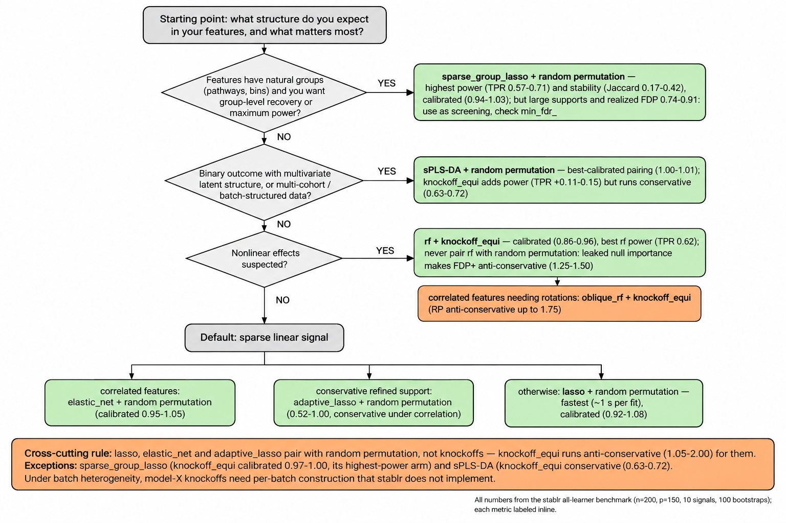

# Which base learner should I use for `stabl()`?

A thorough comparison of all seven `stabl_fit()` base learners to ground
learner choice, with the artificial-feature pairing made explicit. Every
number below comes from this benchmark; the decision tree summarizes it.



The tree's inline numbers are from the binomial benchmark below; the
Gaussian extension (bottom section) lists what changes and what transfers.

## Benchmark design

- **Learners**: `lasso`, `elastic_net` (alpha 0.5), `adaptive_lasso`,
  `sparse_group_lasso` (15 contiguous groups of 10), `splsda` (ncomp 2),
  `rf`, `oblique_rf` (both 500 trees).
- **DGPs** (binomial, n = 200, p = 150, 10 signals, beta = 1.2/sqrt(10)):
  *independent* — i.i.d. N(0,1) features, signals scattered across the SGL
  groups (misaligned by construction); *block* — 15 blocks of 10 with
  AR(0.6) within block, signals at block starts (groups aligned).
- **Pairings**: random permutation (RP) for every learner;
  `knockoff_equi` (KE) sub-arm for all learners (for rf/oblique_rf this is
  their documented validated pairing; for the glmnet family and sPLS-DA it
  probes the KE miscalibration question).
- **Protocol**: `n_bootstraps = 100`, `lambda_grid = "auto"`,
  `random_state = seed`; 10 seeds (5 for rf/oblique_rf, documented).
  Metrics: TPR over the 10 planted signals, realized FDP, reported
  `min_fdr_`, calibration = realized FDP / reported FDP+ (median over
  seeds), mean pairwise Jaccard stability, runtime.

## Results

Full table: `guide_table.csv`. Means over seeds; calibration is the median
per-seed ratio (realized FDP / reported FDP+; 1.0 = honest, > 1 =
anti-conservative, < 1 = conservative).

| DGP | learner | pairing | TPR | FDP | n_sel | calib | Jaccard | s/fit |
|-----|---------|---------|-----|-----|-------|-------|---------|-------|
| independent | lasso | RP | 0.40 | 0.40 | 8.1 | 1.08 | 0.118 | 0.9 |
| independent | lasso | KE | 0.43 | 0.59 | 23.1 | 1.76 | 0.074 | 2.0 |
| independent | elastic_net | RP | 0.42 | 0.49 | 10.8 | 1.00 | 0.105 | 1.0 |
| independent | elastic_net | KE | 0.52 | 0.58 | 29.3 | 1.11 | 0.099 | 1.5 |
| independent | adaptive_lasso | RP | 0.35 | 0.45 | 7.1 | 1.00 | 0.085 | 1.5 |
| independent | adaptive_lasso | KE | 0.46 | 0.58 | 26.8 | 1.67 | 0.088 | 2.3 |
| independent | sparse_group_lasso | RP | 0.57 | 0.85 | 54.3 | 1.03 | 0.171 | 6.2 |
| independent | sparse_group_lasso | KE | 0.77 | 0.90 | 86.1 | 1.00 | 0.388 | 7.3 |
| independent | splsda | RP | 0.35 | 0.37 | 6.6 | 1.00 | 0.112 | 26.7 |
| independent | splsda | KE | 0.50 | 0.48 | 17.1 | 0.63 | 0.139 | 28.5 |
| independent | rf | RP | 0.40 | 0.54 | 10.4 | 1.25 | 0.094 | 6.2 |
| independent | rf | KE | 0.62 | 0.70 | 22.0 | 0.92 | 0.153 | 6.9 |
| independent | oblique_rf | RP | 0.34 | 0.53 | 9.4 | 1.00 | 0.091 | 18.3 |
| independent | oblique_rf | KE | 0.50 | 0.51 | 13.0 | 0.86 | 0.119 | 20.2 |
| block | lasso | RP | 0.43 | 0.40 | 11.1 | 0.92 | 0.081 | 1.2 |
| block | lasso | KE | 0.40 | 0.64 | 15.0 | 2.00 | 0.082 | 2.1 |
| block | elastic_net | RP | 0.35 | 0.40 | 8.9 | 0.95 | 0.063 | 1.0 |
| block | elastic_net | KE | 0.45 | 0.53 | 25.8 | 1.05 | 0.094 | 2.0 |
| block | adaptive_lasso | RP | 0.30 | 0.29 | 6.8 | 0.52 | 0.067 | 1.5 |
| block | adaptive_lasso | KE | 0.37 | 0.48 | 9.6 | 1.03 | 0.085 | 2.5 |
| block | sparse_group_lasso | RP | 0.71 | 0.74 | 98.5 | 0.94 | 0.423 | 6.8 |
| block | sparse_group_lasso | KE | 0.73 | 0.91 | 85.2 | 0.97 | 0.380 | 9.3 |
| block | splsda | RP | 0.32 | 0.40 | 5.7 | 1.00 | 0.093 | 26.9 |
| block | splsda | KE | 0.43 | 0.41 | 10.5 | 0.72 | 0.093 | 28.5 |
| block | rf | RP | 0.20 | 0.40 | 3.6 | 1.50 | 0.124 | 6.1 |
| block | rf | KE | 0.38 | 0.70 | 17.8 | 0.96 | 0.065 | 6.8 |
| block | oblique_rf | RP | 0.52 | 0.63 | 23.6 | 1.75 | 0.099 | 19.1 |
| block | oblique_rf | KE | 0.54 | 0.47 | 28.8 | 0.75 | 0.080 | 18.9 |

Figures: `figA_tpr_fdp.png` (TPR vs FDP per seed and mean),
`figB_calibration.png`, `figC_stability.png`, `figD_runtime.png`.

## How to read this: five decision rules

1. **Natural feature groups, or maximum power/stability wanted →
   `sparse_group_lasso` + RP.** It dominates power (TPR 0.57-0.71 with RP,
   0.73-0.77 with KE) and stability (Jaccard 0.17-0.42 vs 0.06-0.15 for
   everything else), and its FDP+ estimate stays honest (0.94-1.03). But it
   buys power with
   *large* supports (54-99 features) at realized FDP 0.74-0.91: the FDP+
   rule reports this honestly (reported 0.81-0.99) yet still selects,
   because the argmin rule has no "select nothing" exit. Treat SGL fits
   with high `min_fdr_` as screening, not discovery lists.
2. **Binary outcome with latent multivariate structure, or multi-cohort /
   batch-structured data → `splsda` + RP** (the new experimental learner).
   Best-calibrated pairing everywhere (1.00 here; 1.01 on the multi-cohort
   MINT benchmark, see `../mint_comparison/`). `knockoff_equi` adds power
   (TPR +0.11-0.15) but runs conservative (0.63-0.72) — you are leaving
   error budget unspent, which is the safe direction.
3. **Nonlinear effects → `rf` + `knockoff_equi`.** Best rf power
   (TPR 0.62 vs 0.40 for RP, independent DGP) with honest calibration
   (0.86-0.96). Never pair rf with RP: the documented importance-leakage
   warning is realized here (calibration 1.25-1.50 anti-conservative).
   `oblique_rf` only for correlated features needing rotations, and pair
   it with KE too (RP ran anti-conservative, up to 1.75 on blocks).
4. **Default sparse linear signal → `lasso` + RP** (fastest, ~1 s per
   fit, calibrated 0.92-1.08); `elastic_net` + RP when features are
   correlated (calibrated 0.95-1.05); `adaptive_lasso` + RP when you want
   a conservative refined support (0.52-1.00 — conservative under
   correlation, honest otherwise).
5. **Pairing rule (cross-cutting): for `lasso`, `elastic_net`, and
   `adaptive_lasso`, use RP, not knockoffs.** KE ran anti-conservative for
   these three on both DGPs (1.05-2.00). Two exceptions: for
   `sparse_group_lasso`, KE stays calibrated (0.97-1.00) and is the
   highest-power arm in the benchmark (TPR 0.73-0.77) — the choice there is
   a power/FDP trade-off (realized FDP 0.90-0.91), not a calibration one;
   for `splsda`, KE runs conservative (0.63-0.72) — safe, but leaves error
   budget unspent. Under batch heterogeneity the model-X construction
   itself fails (single Gaussian pooled over cohorts), and
   `knockoff_mvr` does not repair it — see
   `../mint_comparison/modelx_extension/`.

## Gaussian-outcome extension: do the rankings transfer?

Same design with a continuous outcome: `family = "gaussian"`,
y = Xbeta + N(0, 1.2^2) (R^2 ~ 0.5), same two DGPs, same protocol
(100 bootstraps, auto grids, RP + knockoff_equi, 10/5 seeds; 200 runs).
`splsda` is classification-only (mixOmics sPLS-DA has no gaussian
variant) and drops out — the closest analogue, sparse PLS regression, is
not implemented as a stablr learner. Full table:
`lb_gauss_summary.csv`; transfer table: `lb_transfer_verdict.csv`;
figures `figE_calibration_transfer.png`, `figF_tpr_transfer.png`.

| DGP | learner | pairing | TPR | FDP | n_sel | calib | Jaccard | s/fit |
|-----|---------|---------|-----|-----|-------|-------|---------|-------|
| independent | lasso | RP | 0.83 | 0.08 | 9.2 | 0.50 | 0.590 | 1.0 |
| independent | lasso | KE | 0.79 | 0.77 | 48.5 | 5.99 | 0.208 | 2.2 |
| independent | elastic_net | RP | 0.79 | 0.09 | 8.8 | 0.00 | 0.547 | 0.9 |
| independent | elastic_net | KE | 0.90 | 0.81 | 65.9 | 4.55 | 0.288 | 1.5 |
| independent | adaptive_lasso | RP | 0.77 | 0.12 | 8.9 | 1.00 | 0.496 | 2.0 |
| independent | adaptive_lasso | KE | 0.63 | 0.18 | 18.3 | 0.17 | 0.276 | 3.1 |
| independent | sparse_group_lasso | RP | 0.76 | 0.87 | 74.0 | 0.97 | 0.316 | 3.7 |
| independent | sparse_group_lasso | KE | 0.99 | 0.92 | 124.1 | 1.01 | 0.704 | 4.3 |
| independent | rf | RP | 0.56 | 0.20 | 7.4 | 2.00 | 0.248 | 9.7 |
| independent | rf | KE | 0.86 | 0.44 | 17.6 | 0.64 | 0.306 | 13.7 |
| independent | oblique_rf | RP | 0.64 | 0.16 | 7.8 | 2.00 | 0.367 | 35.3 |
| independent | oblique_rf | KE | 0.86 | 0.42 | 24.8 | 0.40 | 0.256 | 34.2 |
| block | lasso | RP | 0.58 | 0.07 | 6.2 | 0.00 | 0.369 | 1.6 |
| block | lasso | KE | 0.66 | 0.77 | 41.3 | 5.57 | 0.150 | 3.5 |
| block | elastic_net | RP | 0.65 | 0.11 | 7.3 | 0.75 | 0.413 | 1.2 |
| block | elastic_net | KE | 0.75 | 0.72 | 36.9 | 4.73 | 0.172 | 2.8 |
| block | adaptive_lasso | RP | 0.65 | 0.14 | 7.5 | 1.00 | 0.388 | 2.5 |
| block | adaptive_lasso | KE | 0.70 | 0.29 | 19.6 | 0.50 | 0.291 | 3.9 |
| block | sparse_group_lasso | RP | 0.37 | 0.36 | 44.6 | 0.00 | 0.111 | 3.9 |
| block | sparse_group_lasso | KE | 0.99 | 0.92 | 129.2 | 0.95 | 0.754 | 5.3 |
| block | rf | RP | 0.62 | 0.29 | 9.8 | 2.00 | 0.234 | 9.6 |
| block | rf | KE | 0.52 | 0.40 | 21.2 | 0.60 | 0.090 | 12.6 |
| block | oblique_rf | RP | 0.64 | 0.29 | 9.4 | 4.00 | 0.288 | 36.5 |
| block | oblique_rf | KE | 0.56 | 0.32 | 19.2 | 0.43 | 0.113 | 30.9 |

**Transfer verdict.**

1. **Power rankings do NOT transfer** (Spearman rho = -0.18 for RP-arm
   TPR ranks across regimes). The linear learners rise sharply — the
   gaussian signal is exactly their setting (lasso+RP TPR 0.83 vs 0.40
   binomial, independent DGP) — while rf's binomial advantage disappears
   on the linear signal and SGL+RP collapses on blocks (0.71 -> 0.37: its
   RP FDP+ curve went conservative there, reported ~ 1.0, so the argmin
   rule landed on a sparse support). Choose the learner for the *signal
   structure*, and re-validate when the outcome family changes.
2. **FDP rankings DO transfer** (rho = 0.86): a learner's relative
   honesty is a stable property across outcome families.
3. **Calibration patterns transfer qualitatively, with one quantitative
   escalation.** rf/oblique_rf + RP is anti-conservative in both regimes
   and *worse* in gaussian (2.0-4.0 vs 1.25-1.75) — the leakage warning
   strengthens; KE remains the right rf pairing (0.40-0.64). lasso and
   elastic_net + KE are anti-conservative in both but catastrophically so
   in gaussian (4.6-6.0 vs 1.05-2.0: reported FDP+ ~ 0.12-0.18 while
   realized FDP ~ 0.7-0.8) — the "glmnet trio pairs with RP" rule
   strengthens. SGL + KE stays honest in both (0.95-1.01) and is the
   extreme power arm (TPR 0.99 at realized FDP 0.92, Jaccard 0.70-0.75).
   One pairing flips regime: adaptive_lasso + KE went from
   anti-conservative (1.35 binomial) to conservative (0.17-0.50
   gaussian). RP for the glmnet trio is never anti-conservative in
   either regime (conservative-to-calibrated) — the safe default
   transfers.

## Caveats

- rf/oblique_rf: 5 seeds (slow); all other cells 10 seeds. Differences
  within ~0.1 TPR/FDP are not resolved.
- One regime: n = 200, p = 150, 10 signals, beta = 1.2/sqrt(10), binomial.
  Power rankings (especially SGL's group advantage and rf's nonlinear
  advantage) are regime-dependent; calibration ratios are the more
  transferable column.
- SGL used contiguous groups of 10: aligned with the block DGP's
  correlation structure, deliberately misaligned with the scattered
  signals of the independent DGP. SGL's independent-DGP power (0.57-0.77)
  is therefore a *misaligned-groups* result.
- `ordinal` is excluded: it targets ordered-band outcomes (different
  family), stays experimental, and its graduation bar was not met
  (`benchmarks/ws9_summary.md`).
- The binomial tables are classification (binomial); the Gaussian
  extension covers the continuous-outcome regime. splsda exists only for
  binomial; rf/oblique_rf gaussian variants were benchmarked only in the
  extension.

## Reproducibility

```bash
Rscript learner_benchmark.R           # binomial run (240 tasks, ~15 min on 8 cores)
Rscript learner_benchmark_gauss.R     # gaussian extension (200 tasks)
PILOT=1 Rscript learner_benchmark.R   # smoke tests
Rscript learner_bench_analysis.R      # binomial figures + guide_table.csv
Rscript learner_bench_transfer.R      # regime-transfer figures + verdict table
```

Checkpoints: one RDS per (DGP, learner, pairing, seed) in
`/mnt/shared-workspace/shared/learner_bench/` (binomial) and
`/mnt/shared-workspace/shared/learner_bench_gauss/` (gaussian); reruns
skip completed cells.
