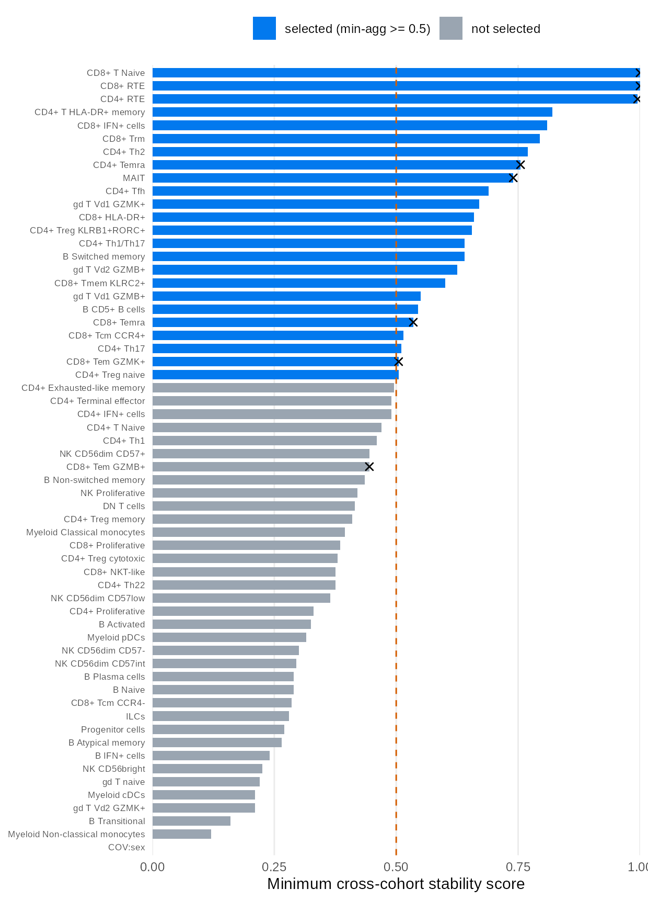
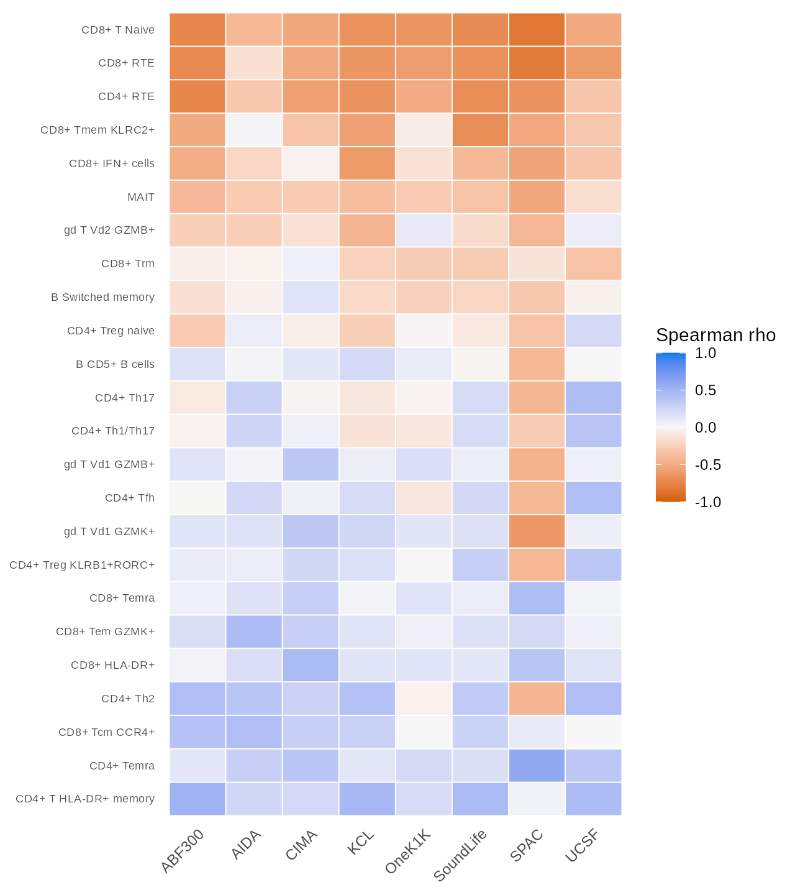
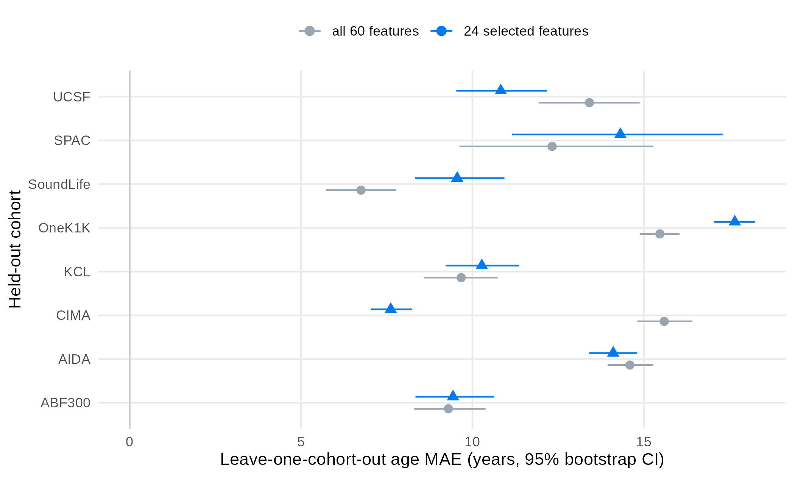
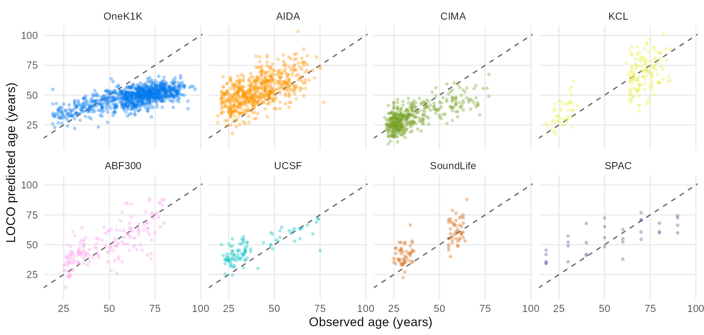
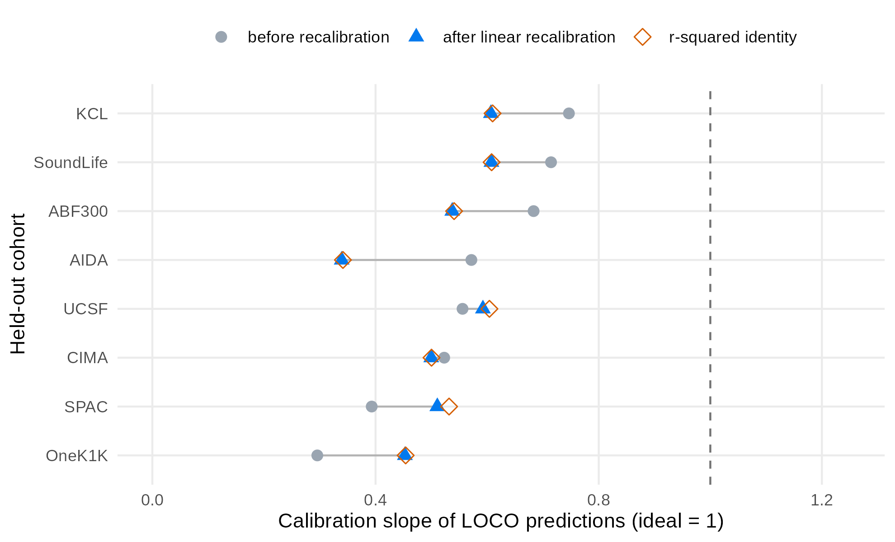
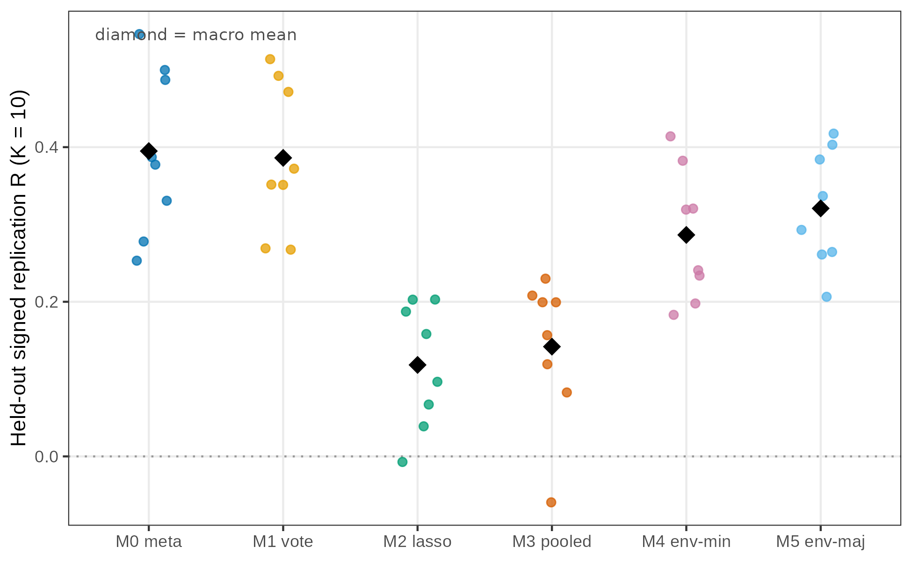
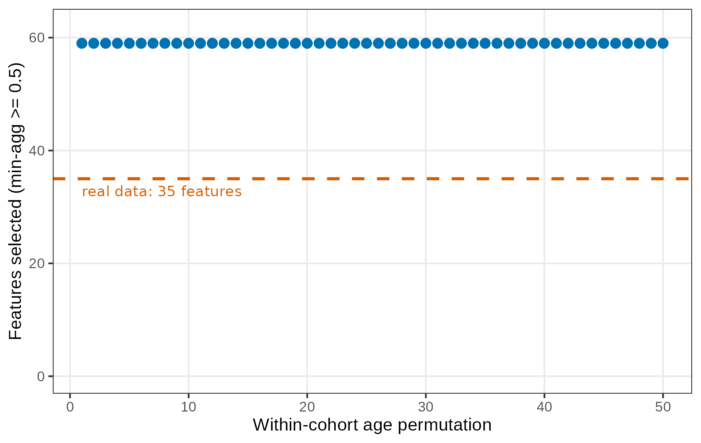

```{r setup, include = FALSE}
knitr::opts_chunk$set(
  collapse = TRUE,
  comment  = "#>",
  fig.width  = 7,
  fig.height = 5
)
```

```{r abstract, echo = FALSE, results = "asis"}
cat(
"> **Summary.** We apply the `stablr` environment-stability workflow to a
> public aging atlas. The atlas has 2,609 donors from eight scRNA-seq
> cohorts. The workflow finds 24 of 60 features that track age in every
> cohort. This full-atlas selection is exploratory. Per-cohort knockoff
> diagnostics (FDP+) are close to 1 on this atlas. The selection bar is
> therefore a descriptive reproducibility filter, not calibrated error
> control. Seven of eight
> age-associated cell types from the source publication pass the selection
> bar. All eight keep the same direction of effect in all cohorts. Models
> trained on seven cohorts predict age in the eighth cohort. The all-feature
> model reaches a mean absolute error of 6.7 to 15.6 years, depending on the
> held-out cohort.
> The selected-panel model uses features chosen with all eight cohorts.
> Its error is a post-selection estimate, not complete-pipeline held-out
> validation. A selection-isolated LOCO that re-selects inside each
> training partition gives a pooled error of 12.3 years.
> This vignette is an application case study. It is not
> calibration evidence for the method.
", sep = ""
)
```

```{r status, echo = FALSE, results = "asis"}
cat(
"> **Status of this vignette (2026-10-15).** This vignette is the
> historical *exploratory* analysis (v1). A prospective revision with a
> locked protocol, a leakage-proof engine, a six-selector matrix, and a
> permutation null has since been completed (v2). Section 10 summarizes
> the v2 design and findings; the v2 package lives in
> `benchmarks/ws8_v2/`. Three v1 defects found by audit are flagged
> where they occur: the exported `mean_score` and `selected_lasso`
> columns are entirely missing (so the lasso sensitivity claim is not
> verifiable from the committed table), and the script-level and
> vignette-level MAE summaries used different estimands (micro vs macro).
> The v1 numbers below are otherwise as committed. Where v1 and v2
> differ, v2 is authoritative.
", sep = ""
)
```

# Contents

- 1 Background and aims
- 2 Data
- 3 Statistical methods
- 4 Result: features that track age in every cohort
- 5 Result: age prediction on held-out cohorts
- 6 Result: per-cohort recalibration
- 7 Discussion
- 8 Limits
- 9 Reproducibility
- 10 The v2 prospective revision
- References

# 1 Background and aims

A biomarker panel must work in new cohorts. A feature can track age in one
cohort and fail in the next. Cohort differences in cell composition can
cause this failure. Differences in sample processing can cause it too.
Chance can also cause it.

The environment-stability workflow in `stablr` fits the selection procedure
in each cohort separately. It then keeps only the features that pass the
selection bar in all cohorts.

This case study asks two questions:

1. Which cell-type features track age in the same direction in all eight
   cohorts?
2. Do the selected features predict age in a cohort that the model did not
   see?

The analysis ran once with a fixed seed. The analysis script is
`benchmarks/ws8_aging_showcase.R` in the package source. The figures
and statistics tables come from `benchmarks/ws8_figures.R` and
`benchmarks/ws8_recalibration.R`. The pipeline takes about 15
minutes. The post-review follow-up analyses add about one hour, most of
it the selection-isolated LOCO. This vignette shows the saved results.

# 2 Data

## 2.1 Source and availability

The data come from a public healthy-aging PBMC atlas (Terekhova et al.
2026, *Immunity*). The Artyomov lab single-cell portal distributes the
atlas (dataset `pan_atlas_healthy_aging_all_celtypes`). We downloaded the
per-cell annotation table `all_cells_metadata.csv.gz` on 2026-10-13. The
file has 13,137,775 cells (MD5 `50651968855bf6ca3efcdf199e2a9fd5`). Each
row is one cell. The columns include donor id, age, sex, CMV status,
ancestry, cohort, and cell-type annotation.

## 2.2 Cohorts

| Cohort | Donors |
|---|---|
| OneK1K | 981 |
| AIDA | 625 |
| CIMA | 421 |
| KCL | 188 |
| ABF300 | 166 |
| UCSF | 99 |
| SoundLife | 96 |
| SPAC | 33 |
| **Total** | **2609** |

The cohorts differ in size, ancestry mix, and age range. Cohort identity
explains the largest share of variance in the atlas (Terekhova et al.
2026). This property makes the atlas a strong test for transportability.

## 2.3 Donor-level feature construction

Each donor is one sample. For each donor and each cell type, we compute a
smoothed proportion: (count + 0.5) / (total + 0.5). We then apply the logit
transform. This gives 59 cell-type features. One covariate (sex, coded
Female = 1) joins the panel.

Three covariate columns are constant inside at least one cohort: CMV status
and two ancestry indicators. The analysis drops them. A constant column has
no within-cohort signal. Its zero variance also breaks the equicorrelated
knockoff construction. No cell-type feature is constant in any cohort.

The final panel has 60 features. The outcome is donor age in years. The
environments are the eight cohorts.

The donor-level count table was derived from the per-cell annotation
table before the analysis script runs. That derivation script is not part
of the package source. The predesign predeclares excluding cells flagged
Bad quality. This vignette cannot verify that step.

# 3 Statistical methods

## 3.1 Selection procedure

This section uses four defined terms:

- **Selection frequency**: how often a feature is selected across 200
  bootstrap resamples of one cohort.
- **Decoy feature**: a knockoff artificial feature. It carries no signal.
  A real feature must beat the decoys to be selected.
- **Min-agg score**: the minimum selection frequency of a feature across
  the eight cohorts.
- **Consistent feature**: a feature with a min-agg score of at least 0.5.

For each cohort separately, `stabl_environment_stability()` runs the STABL
procedure (Hédou et al. 2024) with these settings:

- Base learner: random forest (`ranger`, 500 trees, permutation
  importance).
- Decoys: model-X equicorrelated knockoff features, injected at a 1:1
  ratio.
- Resampling: 200 bootstrap resamples, classic bootstrap design
  (`sample_fraction = 1`, `replace = TRUE`).
- Seed: 20261013.

The min-agg rule follows the aggregation of the WS-5 simulation study.
That study measured FDP+ between 0.083 and 0.142 across shift and drift
designs. Section 4.1 reports the FDP+ diagnostics of this atlas. They do
not reproduce the WS-5 calibration here. See
`?stabl_environment_stability`.

## 3.2 Uncertainty and sign consistency

The selection frequency is a binomial proportion over 200 resamples. For
each feature, we report the exact 95% Clopper–Pearson interval of the
weakest cohort. The weakest cohort sets the min-agg score. The interval
covers one binomial proportion. It does not account for the min-agg rule
taking the minimum over eight cohorts.

We also test the direction of each feature with an exact sign test. A
feature with the same correlation sign in 8 of 8 cohorts has p = 0.0078.
The sign test assumes between-cohort independence.

## 3.3 Sensitivity analysis

The primary analysis uses the random-forest learner. The WS-2 simulation
calibrated this learner for gaussian problems with up to a few dozen
predictors (mean FDP+ 0.025 linear, 0.065 nonlinear). See
`?make_ranger_adapter`.

As a sensitivity analysis, we repeat the full workflow with the lasso
learner. The knockoff type, the bootstrap count, and the seed stay the
same. The lasso can be anti-conservative in some regimes (WS-2: FDP+ 0.58
at p = 50). We read the lasso result as a direction check only.

## 3.4 Age prediction

We use leave-one-cohort-out (LOCO) evaluation. Each fold trains a ridge
model (`glmnet`, alpha = 0, 5-fold internal CV) on seven cohorts. The fold
then predicts donor age in the eighth cohort. We evaluate two models: ridge
on all 60 features, and ridge on the 24 consistent features.

The two models answer different questions. The all-feature model is a
genuine held-out evaluation: the held-out cohort plays no role in the
feature set or the fit. The selected-panel model is different. The 24
features were chosen with all eight cohorts, including the held-out one.
Its LOCO error is therefore a post-selection estimate. It is apparent for
the selection procedure, not an unbiased held-out error for the full
workflow. Section 5.1 reports a selection-isolated LOCO, which re-selects
features inside each seven-cohort training partition.

We report three quantities per held-out cohort:

- Mean absolute error (MAE) with 95% bootstrap intervals. The intervals
  use 2,000 donor-level resamples inside the held-out cohort.
- Calibration slope. This slope comes from a linear fit of predicted age
  on observed age. This is the inverse of the usual observed-on-predicted
  calibration regression. The two agree only at perfect calibration. A
  slope of 1 is ideal. A slope below 1 means the predictions shrink toward
  the middle of the age range.
- Pearson correlation between predicted and observed age.

# 4 Result: features that track age in every cohort

The min-agg rule selects **24 of the 60 features**. Figure 1 ranks all
features by min-agg score. The grey whiskers show the exact 95% interval of
the weakest cohort. The dashed line is the 0.5 bar. Crosses mark the eight
features that the source publication predeclared as age-associated.



## 4.1 The selection bar is not FDR-controlled on this atlas

Each per-cohort fit carries its own knockoff decoys, so each fit has an
FDP+ diagnostic. The predesign asked for these diagnostics as success
criterion 2. They were computed inside every fit but not reported. Table 1
reports them. The result is adverse.

Table 1: Per-environment FDP+ diagnostics (rf + knockoff_equi, 200
bootstraps). "FDP+ at 0.5 bar" evaluates the diagnostic at the threshold
of the min-agg rule. The last two columns count features whose
maximum-over-lambda score passes 0.5.

| Cohort | n | Min FDP+ (threshold) | FDP+ at 0.5 bar | Real ≥ 0.5 | Decoys ≥ 0.5 |
|---|---|---|---|---|---|
| ABF300 | 166 | 1.00 (0.99) | 1.03 | 59 | 60 |
| AIDA | 625 | 1.00 (0.98) | 1.03 | 59 | 60 |
| CIMA | 421 | 0.92 (0.85) | 1.03 | 59 | 60 |
| KCL | 188 | 0.94 (0.85) | 1.05 | 40 | 42 |
| OneK1K | 981 | 1.02 (1.00) | 1.03 | 59 | 60 |
| SoundLife | 96 | 0.89 (0.93) | 1.04 | 56 | 57 |
| SPAC | 33 | 0.95 (0.77) | 1.03 | 36 | 38 |
| UCSF | 99 | 0.89 (0.55) | 1.04 | 48 | 51 |

In every cohort, decoy features pass the 0.5 bar as often as real
features. Even the best threshold per cohort leaves FDP+ between 0.89 and
1.02. The WS-5 calibration (0.083 to 0.142) does not transfer to this
atlas. Plausible causes include the compositional feature space, the
max-over-lambda score, and cohorts with fewer donors than features. This
case study does not pick a cause.

The reading changes accordingly. On this atlas, the min-agg rule is a
descriptive reproducibility filter. It is not calibrated FDR control. The
evidence for the selected panel is the sign consistency below, the
agreement with the predeclared features, and the held-out prediction
results. It is not the knockoff calibration.

Table 2 lists the eight predeclared features. Seven of eight pass the bar.
The near-miss is CD8+ Tem GZMB+ with a score of 0.445. Its interval
includes 0.5. The data cannot separate it from the bar. The predeclared
rule does not select it.

Table 2: Predeclared features under the min-agg rule. The interval is the
exact 95% Clopper–Pearson interval of the weakest cohort. The sign test is
exact and two-sided. All rows have the same sign in 8 of 8 cohorts
(p = 0.0078).

| Feature | Min-agg score | 95% CI | Mean rho | Selected |
|---|---|---|---|---|
| CD8+ T Naive | 1.000 | [0.98, 1.00] | −0.63 | yes |
| CD8+ RTE | 1.000 | [0.98, 1.00] | −0.59 | yes |
| CD4+ RTE | 0.995 | [0.97, 1.00] | −0.55 | yes |
| CD4+ Temra | 0.755 | [0.69, 0.81] | +0.28 | yes |
| MAIT | 0.740 | [0.67, 0.80] | −0.33 | yes |
| CD8+ Temra | 0.535 | [0.46, 0.61] | +0.15 | yes |
| CD8+ Tem GZMK+ | 0.505 | [0.43, 0.58] | +0.19 | yes |
| CD8+ Tem GZMB+ | 0.445 | [0.37, 0.52] | +0.23 | no |

All eight directions agree with the source publication. The naive and
recent-thymic-emigrant compartments fall with age. MAIT falls with age. The
terminal-effector compartments rise with age.

Figure 2 shows the per-cohort Spearman correlation for the 24 consistent
features. Three observations matter:

1. The top rows are sign-consistent and moderately strong in all cohorts.
   These rows are CD8+ T Naive, CD8+ RTE, CD4+ RTE, and MAIT.
2. Only 11 of the 24 consistent features reach sign-test significance at
   0.05 (uncorrected; 24 tests). The panel has a strongly replicable core
   and a weaker periphery.
3. SPAC (n = 33) flips the sign of several weak features. Small cohorts
   dominate the sign pattern of weak rows.



The lasso sensitivity analysis selects 6 features under the same rule. CD8+
T Naive is the only feature that both learners select. The agreement is
partial. The lasso result supports the direction of the primary result. It
does not reproduce the full 24-feature panel.

*Audit note (v2): the exported `selected_lasso` column is missing for all
60 features in the committed results table (a name-stripping defect in the
export). The "6 features" count above is therefore not verifiable from the
committed artifact; treat it as a narrative claim from the run log. The v2
revision replaces this sensitivity with a matched-budget lasso stability
comparator (selector M2, Section 10).*

## 4.2 Which cohort sets the bar

The min-agg score is a minimum over cohorts. For all 24 selected features,
that minimum is set by one of the five smallest cohorts. SPAC (n = 33)
sets it for 10 of 24 features (12 of 24 if ties count; two features have a
selection frequency of 1.000 in all eight cohorts). UCSF (n = 99) sets it
for 7, KCL (n = 188) for 4, ABF300 (n = 166) for 2, and SoundLife
(n = 96) for 1. No minimum is set by one of the three large cohorts.

SPAC is the weakest link. It has fewer donors than features (33 < 60).
The equicorrelated knockoff covariance is therefore a positive-definite
projection of a rank-deficient sample covariance. A bootstrap resample of
33 donors contains about 21 unique donors. The claim that a feature
"tracks age in every cohort" is limited by SPAC for 10 of the 24
features.

## 4.3 Sensitivity: min-agg without SPAC

We repeat the min-agg rule over the seven cohorts without SPAC. The panel
grows from 24 to 33 features. Nine features join; none leave. The
predeclared set keeps its status: CD8+ Tem GZMK+ rises from 0.505 to
0.660; the other seven scores do not change. Given the FDP+ result above,
neither panel size is calibrated. The sensitivity shows that panel
membership depends on the smallest cohort. It does not show that the
larger panel is better.

# 5 Result: age prediction on held-out cohorts

Table 3 and Figure 3 give the LOCO results. Read the two columns as
different estimands. The all-feature column is a genuine held-out
evaluation. The selected column is a post-selection estimate, because the
24 features were chosen with all eight cohorts. The all-feature model
predicts age with MAE between 6.7 years (SoundLife) and 15.6 years (CIMA).
The selected-feature model helps two cohorts clearly: CIMA (15.6 to 7.6
years) and UCSF (13.4 to 10.8 years). It hurts two others: OneK1K (15.5 to
17.7 years) and SoundLife (6.7 to 9.6 years). The overall means (12.1 and
11.7 years) hide this heterogeneity.

*Audit note (v2): the means quoted here are macro means (unweighted over
cohorts). The analysis script's own pooled summary was a micro mean
(donor-weighted, 14.0 years for the all-feature model). The two estimands
were presented under one name in v1; v2 reports both, explicitly labeled
(Section 10).*

A paired per-donor comparison makes this precise (Table 4). For each
donor, we take the difference of absolute errors (all-feature minus
selected; positive favors the panel). The improvement is 8.0 years
[7.3, 8.7] in CIMA and 2.6 [1.9, 3.3] in UCSF. The loss is 2.2
[−2.5, −1.9] in OneK1K and 2.8 [−3.9, −1.6] in SoundLife. ABF300, KCL,
and SPAC show no clear difference. Pooled over all donors, the panel
improves the MAE by 0.5 years [0.3, 0.7]. The paired intervals resolve
the overlap of the marginal intervals in Table 3: the UCSF improvement is
real. One caveat: the two models differ in covariates. The all-feature
model includes sex; the selected panel does not (sex was not selected).
The paired comparison mixes a change of feature set with a change of
covariate set.

Table 3: LOCO age prediction. MAE in years with 95% bootstrap intervals.
The all-feature column is a genuine held-out evaluation. The selected
column is a post-selection estimate: the 24 features were chosen with all
eight cohorts, so its error is optimistic for the full workflow.

| Cohort | n | MAE all features (95% CI) | MAE selected (95% CI) |
|---|---|---|---|
| ABF300 | 166 | 9.30 [8.30, 10.38] | 9.43 [8.34, 10.63] |
| AIDA | 625 | 14.60 [13.95, 15.28] | 14.11 [13.41, 14.81] |
| CIMA | 421 | 15.60 [14.81, 16.42] | 7.62 [7.04, 8.24] |
| KCL | 188 | 9.67 [8.58, 10.74] | 10.27 [9.22, 11.36] |
| OneK1K | 981 | 15.47 [14.89, 16.05] | 17.65 [17.05, 18.25] |
| SoundLife | 96 | 6.75 [5.72, 7.78] | 9.56 [8.32, 10.94] |
| SPAC | 33 | 12.33 [9.62, 15.28] | 14.32 [11.16, 17.31] |
| UCSF | 99 | 13.41 [11.93, 14.88] | 10.83 [9.53, 12.17] |

Table 4: Paired per-donor MAE difference (all-feature minus selected
panel), in years, with 95% bootstrap intervals (2,000 donor-level
resamples per cohort; the pooled interval uses cohort-stratified
resampling). Positive values favor the selected panel.

| Cohort | n | Difference (95% CI) |
|---|---|---|
| ABF300 | 166 | −0.13 [−0.92, 0.62] |
| AIDA | 625 | +0.49 [0.08, 0.89] |
| CIMA | 421 | +7.98 [7.30, 8.67] |
| KCL | 188 | −0.60 [−1.57, 0.32] |
| OneK1K | 981 | −2.18 [−2.47, −1.90] |
| SoundLife | 96 | −2.81 [−3.92, −1.65] |
| SPAC | 33 | −1.99 [−4.35, 0.44] |
| UCSF | 99 | +2.59 [1.91, 3.27] |
| Pooled | 2609 | +0.50 [0.29, 0.70] |



Figure 4 shows predicted versus observed age for the selected-feature
model. The correlation is between 0.58 and 0.78 (r² between 0.34 and
0.61). Every calibration slope is below 1 (0.30 to 0.75). The predictions
shrink toward the training range in all cohorts. OneK1K shrinks most
(slope 0.30). KCL and SoundLife shrink least (0.71 to 0.75).

The source publication reports 8.2 years test MAE for its trained clock.
Our protocol is simpler and different: a ridge model on donor-level
proportions, trained on seven cohorts and applied to the eighth. The two
numbers are not directly comparable. The honest reading is this.
Composition features carry cross-cohort age signal. The ranking quality is
good. The calibration loss is cohort-specific.



## 5.1 Selection-isolated LOCO

The selected-panel column above is a post-selection estimate. A
selection-isolated LOCO removes the selection leakage. The protocol is
predeclared in the predesign addendum 2. Inside each seven-cohort
training partition, we rerun the full selection (rf + knockoff_equi, 200
bootstraps, min-agg at 0.5 over the seven training cohorts) and predict
the eighth cohort with the within-fold panel.

Table 5: Selection-isolated LOCO. "Panel" is the within-fold panel size.
"Overlap" counts how many of the 24 full-data panel features the fold
re-selects. The last two columns repeat Table 3.

| Cohort | n | Panel | Overlap | MAE selection-isolated (95% CI) | MAE all | MAE post-selection |
|---|---|---|---|---|---|---|
| ABF300 | 166 | 41 | 22 | 9.02 [7.97, 10.13] | 9.30 | 9.43 |
| AIDA | 625 | 41 | 22 | 14.38 [13.69, 15.06] | 14.60 | 14.11 |
| CIMA | 421 | 41 | 22 | 17.04 [16.26, 17.88] | 15.60 | 7.62 |
| KCL | 188 | 41 | 22 | 9.83 [8.78, 10.89] | 9.67 | 10.27 |
| OneK1K | 981 | 29 | 22 | 17.08 [16.49, 17.67] | 15.47 | 17.65 |
| SoundLife | 96 | 29 | 22 | 7.63 [6.57, 8.85] | 6.75 | 9.56 |
| SPAC | 33 | 32 | 22 | 12.75 [9.78, 15.83] | 12.33 | 14.32 |
| UCSF | 99 | 26 | 24 | 10.96 [9.66, 12.37] | 13.41 | 10.83 |
| Pooled | 2609 | — | — | 12.34 | 12.14 | 11.72 |

Three readings matter.

1. The pooled complete-pipeline error is 12.3 years. The post-selection
   mean (11.7) was mildly optimistic, as expected. The all-feature mean
   (12.1) is close to the complete-pipeline value.
2. The CIMA improvement does not survive selection isolation. The
   within-fold panel has 41 features and predicts CIMA with 17.0 years,
   worse than the all-feature model (15.6). The improvement in Table 3
   (15.6 to 7.6) is specific to the fixed full-data panel. It is a
   property of that panel, not of the workflow.
3. The UCSF improvement survives (13.4 to 11.0). The panel core is
   stable: every fold re-selects at least 22 of the 24 full-data
   features. The same two features (CD4+ Treg naive, CD8+ Temra) drop in
   seven of eight folds.

# 6 Result: per-cohort recalibration

The slope gap raises a practical question. Can a per-cohort recalibration
map fix the compression? We tested this question with a nested design.
This section recalibrates the selected-panel predictions. These are a
post-selection estimand (Section 5). The recalibration numbers inherit
that label. Inside each held-out cohort, we cross-validated the
recalibration map
itself (5 folds, 5 repeats). We compared two maps: a linear map and an
isotonic (monotone) map. All evaluation is out-of-fold.

Recalibration helps where compression dominates. In OneK1K, linear
recalibration halves the selected-panel MAE: from 17.7 to 9.8 years
(post-selection numbers; the all-feature MAE is 15.5). Isotonic gives 9.6
years. AIDA improves from 14.1 to 8.1 years. UCSF improves from 10.8 to
7.0 years. ABF300 does not improve (9.4 to 9.3 years). Its error was
already scatter, not compression. SPAC gets worse (14.3 to 14.9 years). A
cohort of 33 donors cannot support a recalibration map.

The slope gap does not close fully. After linear recalibration, the
out-of-fold slope moves from 0.30 to 0.45 in OneK1K. This value equals the
squared correlation (r² = 0.454). The same identity holds in all eight
cohorts. The largest deviation is 0.02. Figure 5 shows this identity: the
after-recalibration points sit on the r² markers.

The identity has a clear meaning. Recalibration removes the systematic
compression. It cannot remove noise. The remaining slope gap is the share
of variance that the predictions do not explain.



# 7 Discussion

Three findings generalize beyond this atlas.

First, the strongly replicable core is small. Three features have a
selection frequency of at least 0.99 in every cohort: CD8+ T Naive,
CD8+ RTE, and CD4+ RTE. Two more clear 0.8: CD4+ T HLA-DR+ memory (0.82)
and CD8+ IFN+ cells (0.81). The predeclared CD4+ Temra (0.755) and MAIT
(0.740) pass the bar, but their selection frequency is not near 1. The
near-1 core matches the biology of the source publication.
Thymic involution and T-cell compartment restructuring are the most
reproducible immune-aging signatures.

Second, selection frequency and effect size are different quantities. The
min-agg bar asks for replicable selection. It does not ask for a large or
sign-stable correlation. Eleven of the 24 consistent features have weak or
cohort-mixed correlations. A direct comparison makes this concrete. Only 13
of the 24 consistent features also pass a significance vote (significant in
at least 5 of 8 cohorts, BH-adjusted). Eight other features pass that vote
but fail min-agg. The two rules select different feature types. A reader
who needs a compact panel can take the replicable core. A reader who needs
the full panel must treat the periphery as hypotheses.

Third, prediction quality is cohort-specific. The paired per-donor
differences (Section 5) confirm the pattern: the selected panel improves
CIMA by 8.0 years and UCSF by 2.6, and worsens OneK1K by 2.2 and
SoundLife by 2.8. The selection-isolated LOCO tempers the CIMA result:
that improvement is specific to the fixed full-data panel and does not
survive complete-pipeline isolation (Section 5.1).
Cohort identity is the largest variance component of the atlas. No
composition-only model will calibrate uniformly across such cohorts. The
LOCO design makes this cost visible. A pooled metric would hide it.

# 8 Limits

Four limits bound the conclusions.

1. **Application case study, not calibration evidence.** The calibration
   evidence for the random-forest learner is simulation-based (WS-2). That
   evidence covers gaussian problems with up to a few dozen predictors.
   This panel has 60 features. The showcase demonstrates the workflow on
   real data. It does not add calibration guarantees. On this atlas, the
   per-cohort FDP+ diagnostics are close to 1 (Section 4.1). The
   selection bar is a descriptive filter here.
2. **Selected-panel LOCO is post-selection.** The 24 consistent features
   were chosen with all eight cohorts. The selected-panel LOCO error is
   therefore apparent for the selection procedure, not an unbiased
   held-out error for the full workflow. The all-feature LOCO column is
   the genuine held-out evaluation here. A selection-isolated LOCO that
   re-selects features inside each training partition is reported in
   Section 5.1.
3. **The min-agg rule is conservative by design.** A feature must pass the
   bar in every cohort. Features with cohort-specific signal fail the bar.
   Their biology can still be real. CD8+ Tem GZMB+ (score 0.445) is the
   predeclared example. The min-agg score is set by the smallest cohorts
   for all 24 features (Section 4.2).
4. **Composition features are relative.** Logit proportions measure a cell
   type against all typed cells. An increase in one compartment
   mechanically dilutes the others. The direction claims are about
   composition. They are not about absolute abundance.
5. **Single run.** The analysis uses one seed (20261013). The bootstrap
   intervals quantify sampling noise inside that run. They do not cover
   seed-level variation of the full pipeline.

# 9 Reproducibility

- Data: Artyomov lab single-cell portal, dataset
  `pan_atlas_healthy_aging_all_celtypes`, file `all_cells_metadata.csv.gz`.
  MD5 `50651968855bf6ca3efcdf199e2a9fd5`. Retrieved 2026-10-13.
- Pipeline: `benchmarks/ws8_aging_showcase.R`. The design was
  predeclared in `benchmarks/ws8_showcase_predesign.md`. Seed
  20261013.
- Figures and statistics: `benchmarks/ws8_figures.R` and
  `benchmarks/ws8_recalibration.R`. Outputs:
  `benchmarks/ws8_feature_stats.csv`, `ws8_loco_mae_ci.csv`,
  `ws8_loco_calibration.csv`, `ws8_rule_comparison.csv`,
  `ws8_recalibration.csv`, and `vignettes/figures/`.
- Post-review follow-ups (2026-10-15): `ws8_review_fdp.R`
  (`ws8_fdp_diagnostics.csv`), `ws8_review_sensitivity_nospac.R`
  (`ws8_binding_cohorts.csv`, `ws8_minagg_sensitivity_nospac.csv`),
  `ws8_review_paired_mae.R` (`ws8_paired_mae_diff.csv`), and
  `ws8_loco_selection_isolated.R` (`ws8_loco_silo.csv`,
  `ws8_loco_silo_features.csv`). All read the objects saved by the
  pipeline script; only the last refits.
- Software: R 4.4.2; `stablr` 0.3.0 (this branch); `ranger`, `glmnet`,
  `knockoff`.
- Audit note (v2): in `ws8_results.csv`, the `mean_score` and
  `selected_lasso` columns are missing for all 60 rows (export defects).
  All other committed v1 artifacts check out against the scripts.
- The v2 prospective revision lives in `benchmarks/ws8_v2/` with its
  own locked protocol, claims ledger, and run manifests (Section 10).

# 10 The v2 prospective revision

## 10.1 Why a revision

The v1 analysis above was exploratory. A later audit found export defects
and an estimand conflation (flagged in place above), and the design mixed
selection and evaluation on the same cohorts. The v2 revision rebuilds the
case study as a prospective benchmark with a locked protocol
(`benchmarks/ws8_v2/protocol.md`), a leakage-proof leave-one-cohort-out
(LOCO) engine, six matched selectors, and a permutation null. Every v2
claim traces to a committed, executed artifact in the claims ledger
(`claims_ledger.md`). An independent adversarial review of the v2 package
was performed and all findings were remediated (`review_decisions.md`,
Amendment 1 in `ws8_showcase_predesign.md`).

## 10.2 Design in brief

The feature universe is the 59 harmonized immune cell-type proportions
(sex, CMV, and ancestry are not discovery features). Each of the eight
cohorts is held out in turn. Selectors train on the remaining seven
cohorts only: M0, a random-effects meta-analysis of per-cohort
associations; M1, the source paper's per-cohort adjusted significance vote
(`feature ~ age + sex + ancestry`, BH, at least 5 of 7 cohorts); M2, pooled
lasso stability; M3, pooled STABL; M4, environment-aware STABL with
min-across-cohorts aggregation (the primary method); M5, the same with
majority aggregation. The primary endpoint is the cohort-balanced held-out
directional replication R(K): the mean, over the matched top-K panel
(K = 10), of the training-signed held-out Spearman correlation with age,
averaged over the eight folds. The confirmatory contrasts are M4 versus M0
and M4 versus M3. M3 is the controlled pair for M4: identical learner,
knockoffs, budget, and seed; only the cohort aggregation differs.

## 10.3 Result: held-out association replication

Macro R at K = 10 across the eight held-out cohorts:

| Selector | Macro R@10 |
|---|---|
| M0 meta-analysis | 0.395 |
| M1 adjusted vote | 0.386 |
| M5 env STABL, majority | 0.321 |
| M4 env STABL, min | 0.286 |
| M3 pooled STABL | 0.142 |
| M2 lasso stability | 0.118 |



The confirmatory contrasts (paired over the eight cohorts; intervals are
paired t intervals on 7 degrees of freedom, imprecise at n = 8; p-values
are exact sign-flip tests):

- **M4 − M3 = +0.145 [+0.083, +0.206], p = 0.0078.** Environment-aware
  aggregation adds value over pooled STABL. The difference is positive in
  all eight cohorts. This is the controlled isolation of the aggregation
  step.
- **M4 − M0 = −0.108 [−0.174, −0.043], p = 0.016.** The min-aggregated
  STABL panel replicates *less* well than the simple random-effects
  meta-analysis ranking.

Exploratory contrasts: M4 − M1 = −0.100 (p = 0.023), M4 − M2 = +0.168
(p = 0.0078), M4 − M5 = −0.034 (p = 0.023). The reading is mixed and
partly negative for the primary hypothesis. Environment-aware aggregation
beats pooling the cohorts into one STABL fit, and beats lasso stability.
It does not beat the simpler association-based selectors — the
meta-analysis or the significance vote — at the same feature budget. No
method-superiority claim is made.

A post-merge re-aggregation probe (S2b, 2026-10-16) re-scores the persisted
M4 environment selections at cohort-count quantiles instead of the minimum.
A 25% quantile (M4q25) reaches macro R@10 0.362 — above both M4 (0.287;
paired difference +0.076 [+0.025, +0.127], sign-flip p = 0.023) and M5
(0.321) — while a 10% quantile does not (−0.006, NS). The predeclared
falsification hook fired: strict-min aggregation is suboptimal on this
atlas, not merely conservative. The probe re-uses the persisted M4 scores
without refitting (the q = 0 control reproduces the committed M4 values to
5e-16); it is exploratory and single-atlas (claims ledger V5, upgraded).

## 10.4 Result: the selection count is null-saturated

The S0 null probe permutes age within each cohort (preserving the
features, the cohort structure, and each cohort's age distribution) and
refits the full M4 selector. In 50 of 50 permutations, the min-aggregation
rule selects **59 of 59 features** at the 0.5 bar (Clopper–Pearson 95%
lower bound for the saturation probability: 0.929). The same-design
real-data fit selects 35 of 59. Under the null, the selector selects
everything; the size of the selected panel therefore carries no signal on
this atlas. This is consistent with the v1 knockoff diagnostics (FDP+
close to 1, Section 4.1). Every per-environment fit containing SPAC
(n = 33 donors, fewer than the 59 features) uses a positive-definite
projection of a rank-deficient knockoff covariance, and min-aggregation
gives that smallest cohort veto power; the saturation and the projection
were plausibly related as this section first went to press. A
SPAC-excluded rerun of the full null probe (50 permutations, seven cohorts;
Section 10.8) saturates identically — 50/50 permutations select 59/59
(Clopper–Pearson lower bound 0.942) against 30/59 native on the
SPAC-excluded real-data fit — so the projection is not the mechanism, and
synthetic simulations reproduce the saturation under every truth regime
including the null. The v2 case for the panel rests on the replication
and prediction *rankings* above and below — not on selection being
non-null.



## 10.5 Result: prediction in unseen cohorts

A ridge model on the M4 top-10 panel, tuned by leave-one-training-cohort-out
inner CV, predicts held-out cohort age with macro MAE 12.2 years (micro
13.6), against 12.4 (14.4) for the all-59 model and 20.1 (22.7) for the
training-median baseline. The panel beats the median baseline decisively
(paired per-cohort difference −7.9 years [−11.1, −4.7], sign-flip
p = 0.0078). It does **not** beat the all-59 model systematically
(−0.16 years [−2.84, +2.51], p = 0.93); the macro edge rests on one cohort
(CIMA), and the top-10 panel is worse than all-59 in five of eight
cohorts. Calibration slopes remain below 1 in every cohort (predicted-on-
observed 0.32 to 0.68): predictions compress toward the training range,
as in v1 Section 5.

## 10.6 Result: biology

All eight a priori reference populations keep the same direction of
association in all eight cohorts: naive and recent-thymic-emigrant T cells
and MAIT cells fall with age; terminally differentiated effector-memory
compartments rise. The GZMK+/GZMB+ CD8 effector-memory ratio is
cohort-dependent (negative in six of eight cohorts): a reproducible core
coexists with cohort-dependent components. Per-cohort effect sizes and
heterogeneity are in `benchmarks/ws8_v2/results/biology/`.

## 10.7 What v2 changes

The v1 headline — 24 of 60 features "track age in every cohort" — survives
only in a weaker, audited form. The selection bar is not non-null on this
atlas (Section 10.4), so panel membership itself is not evidence. What
survives is the ranking: the strongest age-associated features replicate
in held-out cohorts under every selector, the eight predeclared
populations are directionally consistent everywhere, and a sparse panel
predicts age in unseen cohorts about as well as the full feature set. For
this endpoint on this atlas, the simplest selectors (meta-analysis or a
significance vote) replicate best; environment-aware STABL's measured
value is its improvement over pooled STABL, not superiority over simpler
baselines.

## 10.8 Post-merge robustness and calibration follow-ups

Four predeclared follow-ups (2026-10-16) probe the v2 findings; the claims
ledger carries the full entries (V11–V15).

- **SPAC exclusion (S2a).** Re-running the six-selector LOCO on the seven
  cohorts without SPAC preserves the ordering (M0 0.408 > M1 0.395 > M5
  0.344 > M4 0.323 > M3 0.190 > M2 0.141) and the confirmatory M4 − M3
  contrast (+0.133 [+0.069, +0.197], p = 0.016). The headline is robust to
  the one cohort whose knockoff covariance needed projection.
- **Aggregation quantile (S2b).** Reported with Section 10.3: a 25%
  quantile aggregation beats both min and majority; the V5 status is
  upgraded from tentative to supported.
- **Knockoff construction (S2c).** Replacing `knockoff_equi` with
  `knockoff_mvr` moves the M4 macro R@10 by −0.002 (0.284 vs 0.286); the
  findings are not an artifact of the equi construction.
- **Synthetic calibration (S1).** A simulator anchored to the real
  per-cohort means, pooled covariance, and empirical ages runs four truth
  regimes (homogeneous, heterogeneous, null, sparse-strong) through the
  same six selectors. M4 and M5 select every native feature under all
  four — including the pure null — with empirical FDP 0.83–1.00: the
  saturation is structural, not an atlas property. Under known truth,
  per-cohort STABL voting (M1) matches the association ranking under
  homogeneity, beats it under heterogeneity, selects nothing under the
  null, and recovers exactly the sparse truth. The pilot runs 5 replicates
  per scenario of a planned 20 (inputs and seeds are committed;
  `benchmarks/ws8_v2/results/s1/`).

# References

- Terekhova et al. (2026), *Immunity*. Healthy-aging PBMC atlas across
  eight cohorts. Source of the data and of the predeclared feature list.
- Hédou, J., Marić, I., Bellan, G. et al. Discovery of sparse, reliable
  omic biomarkers with Stabl. *Nat Biotechnol* (2024).
  [doi:10.1038/s41587-023-02033-x](https://doi.org/10.1038/s41587-023-02033-x)
- Candès, E., Fan, Y., Janson, L. & Jin, J. (2018). Panning for gold:
  model-X knockoffs. *J R Stat Soc B*, 80(3), 551–577.
  [doi:10.1111/rssb.12265](https://doi.org/10.1111/rssb.12265)
